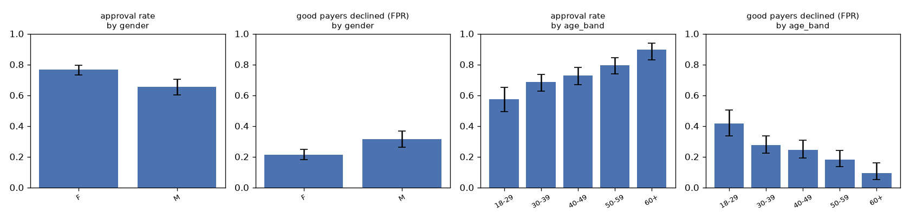

<!-- PROVIDED: copy this file to docs/fairness_analysis.md and fill in every placeholder.
     Use the numbers in reports/fairness/fairness.md (python run.py fairness). -->

# Fairness analysis (Week 6)

Team: 2

## 1. What we compared, and on which data

**Groups.** We compared applicants by **gender** (`CODE_GENDER`: F, M) and by **age band**
(computed from `DAYS_BIRTH`: 18-29, 30-39, 40-49, 50-59, 60+).

**Data.** The 1,000 applicants in the fixed **validation split** (`config/split_ids.csv`) of
the 5,000-applicant working sample, of whom 81 (8.1%) defaulted. We used the validation set
and not the training set because the model has already seen the training applicants: its
scores there are overfitted and would make every group look better than it would in
production. The validation applicants are unseen but have known outcomes, so we can measure
both who is approved and who was declined wrongly.

**Decision rule.** The shipped model (version 1, gradient boosting inside a calibrator) with
our cost-based threshold of **0.085**: an applicant whose estimated probability of default is
0.085 or more is rejected, anyone below it is approved. About 73% of validation applicants are
approved overall.

**Are the attributes model features?** Yes, both are. `CODE_GENDER` and `DAYS_BIRTH` are
among the model's 164 features (`models/model_info.json`; `gender_is_a_model_feature: true`
in `reports/fairness/fairness.json`). The model sees gender and exact age directly, as well
as features correlated with them (section 5).

## 2. The table

Model version 1, threshold 0.085, 1,000 validation applicants. Brackets are 95% Wilson
intervals. TPR = share of the group's defaulters that the model rejects (risk caught).
FPR = share of the group's good payers that the model rejects (wrongly declined).

### By gender

| Group | n | Defaulters | Approval rate | Default rate | Mean score | TPR | FPR |
|---|---|---|---|---|---|---|---|
| F | 669 | 38 | 76.5% [73%, 80%] | 5.7% | 0.072 | 60.5% [45%, 74%] | 21.2% [18%, 25%] |
| M | 331 | 43 | 65.6% [60%, 70%] | 13.0% | 0.098 | 55.8% [41%, 70%] | 31.2% [26%, 37%] |

Largest gaps: approval 11.0 points, TPR 4.7 points, FPR 10.0 points. Lowest / highest
approval rate: 0.857.

### By age band

| Group | n | Defaulters | Approval rate | Default rate | Mean score | TPR | FPR |
|---|---|---|---|---|---|---|---|
| 18-29 | 143 | 16 | 57.3% [49%, 65%] | 11.2% | 0.118 | 50.0% [28%, 72%] | 41.7% [34%, 50%] |
| 30-39 | 282 | 28 | 68.4% [63%, 74%] | 9.9% | 0.091 | 67.9% [49%, 82%] | 27.6% [22%, 33%] |
| 40-49 | 235 | 18 | 72.8% [67%, 78%] | 7.7% | 0.075 | 61.1% [39%, 80%] | 24.4% [19%, 31%] |
| 50-59 | 216 | 13 | 79.6% [74%, 84%] | 6.0% | 0.068 | 53.8% [29%, 77%] | 18.2% [14%, 24%] |
| 60+ | 124 | 6 | 89.5% [83%, 94%] | 4.8% | 0.049 | 33.3% [10%, 70%] | 9.3% [5%, 16%] |

Every age band has fewer than 30 defaulters, so every age TPR is marked unreliable. Largest
gaps: approval 32.2 points, TPR 34.5 points, FPR 32.4 points. Lowest / highest approval
rate: 0.641.

## 3. The gaps

**Gender.** Men are approved less often than women (65.6% vs 76.5%). Most of this follows
the base rate: men in the validation set defaulted more than twice as often (13.0% vs 5.7%),
so a risk model that works should score them as riskier. But the base rate does not explain
all of it. Among **good payers only**, men are declined 31.2% of the time and women 21.2%,
so a man who would have repaid has a much higher chance of being turned away than a woman who
would have repaid. That is a violation of equalized odds (equal FPR). The TPRs are close
(55.8% vs 60.5%), so the model catches risk in the two groups about equally well.

Calibration within group is not perfect. For women the mean score (0.072) is slightly above
the actual default rate (5.7%), which is within the default rate's 95% interval of about
[4.2%, 7.7%]. For men the mean score (0.098) is below the actual default rate (13.0%), right
at the bottom edge of its interval of about [9.8%, 17.0%]. So the model, if anything,
*underestimates* men's risk on average, but still declines more of their good payers. The
higher FPR comes from the spread of male scores: more men, defaulters and good payers alike,
have scores near or above 0.085.

**Age.** Approval rises steadily with age, from 57.3% for 18-29 to 89.5% for 60+. Part of
this is again the base rate: default falls from 11.2% (18-29) to 4.8% (60+). But the FPR gap
is large. A young good payer is declined 41.7% of the time and an older good payer 9.3% of the
time, a factor of about 4.5. Within each age band the model is well calibrated: the mean score
is within about 1 point of the actual default rate in every band (0.118 vs 11.2%, 0.091 vs
9.9%, 0.075 vs 7.7%, 0.068 vs 6.0%, 0.049 vs 4.8%).

**Why calibration and equal FPR conflict.** When base rates differ, a model that is
calibrated in every group generally cannot also have equal FPR and TPR across groups (the
Kleinberg / Chouldechova impossibility result). Our age results are that situation: good
calibration, unequal error rates. A single threshold applied to calibrated scores declines
proportionally more people from the higher-risk group, including its good payers. Whether
that is acceptable is a policy decision, not a statistical one (section 6).

## 4. How sure are we?

**Numbers that rest on few people.** The validation set has only 81 defaulters, so every TPR
is weak. By gender, the TPRs rest on 38 and 43 defaulters and their intervals are 30 points
wide. By age, every band has fewer than 30 defaulters. The 60+ TPR of 33.3% is **2 people out
of 6** (interval 10% to 70%), and the 50-59 TPR rests on 13. These TPRs show nothing about
whether the model catches risk differently by age.

**Gaps that are clearly real (intervals do not overlap):**

- Gender approval rate: F [73%, 80%] vs M [60%, 70%].
- Gender FPR: F [18%, 25%] vs M [26%, 37%]. The intervals are separate but close, so the
  size of the gap (10 points) is uncertain even though its direction is not.
- Age approval rate: 18-29 [49%, 65%] vs 50-59 [74%, 84%] and 60+ [83%, 94%]. Also 30-39
  [63%, 74%] vs 60+.
- Age FPR: 18-29 [34%, 50%] vs 40-49 [19%, 31%], 50-59 [14%, 24%] and 60+ [5%, 16%]. Also
  30-39 [22%, 33%] vs 60+.
- Default rate by gender. The base-rate difference itself is real (about [4%, 8%] vs
  [10%, 17%]).

**Gaps that could be chance:** every TPR gap (gender and age), and the differences between
neighbouring age bands (for example 30-39 vs 40-49 approval and FPR), whose intervals overlap.

**How many applicants we would need.** To detect the gender TPR gap of about 5 points
(60% vs 56%) with 80% power at the 5% level requires about 1,700 defaulters *per group*.
At the observed default rates that means roughly 13,000 men and 30,000 women, about 40,000
applicants, or 40 times our validation set. To detect the age TPR gap between 18-29 (50%) and
60+ (33%) requires about 130 defaulters per band. At a 4.8% default rate the 60+ band would
need about 2,700 applicants, compared with 124 now (about 22,000 applicants in total at the
current age mix). The full Home Credit training data (about 300,000 applicants, about 25,000
defaulters) would be large enough. Our 5,000-applicant sample is not.

## 5. Proxies

**Result.** A gradient boosting classifier that predicts gender from the **other 163
features** (without `CODE_GENDER`) reaches **AUC 0.863** on the validation set, far above 0.5.
The strongest single features are `AMT_INCOME_TOTAL` (0.644), `CREDIT_INCOME_RATIO` (0.599),
`DAYS_BIRTH` (0.593), `EXT_SOURCE_1` (0.585) and `BUREAU_AMT_CREDIT_SUM_MEAN` (0.584).

**What this means for "just remove CODE_GENDER".** Removing the column would not remove gender
information from the model. No single feature is a strong proxy (each one reaches only about
0.6), but together they recover gender well, because the information is spread across many
weakly correlated features. A retrained model without `CODE_GENDER` could still give men and
women different scores through these features, and the FPR gap could stay. Deleting the column
mainly makes the dependence harder to see (fairness through unawareness). The fairness tables
must still be produced *by* gender after the column is removed, because outcome gaps are what
anti-discrimination law (disparate impact) and the applicants experience. The same holds for
age: `DAYS_BIRTH` is itself one of the gender proxies, and age is very likely recoverable from
`DAYS_EMPLOYED`, `DAYS_ID_PUBLISH`, `OWN_CAR_AGE`, pensioner income type and credit-history
length. We did not run an age proxy check, and should.

**Why these features carry gender.** In this population, as in most labour markets, men report
higher incomes on average, so income and the credit-to-income ratio differ by gender. Women in
the data are older on average (and more often pensioners), so age separates the groups.
`EXT_SOURCE_1` is an external credit score that may itself have been built with gender or
gender-correlated inputs. Bureau credit amounts reflect how much past credit each group was
given, which encodes historical lending patterns. The single-feature ranking also skips
categorical features, so occupation type, organization type and family status, which are
strongly gendered, are probably proxies as well but do not appear in that list.

## 6. What we recommend

**We would not ship this model as it is.** It uses `CODE_GENDER` directly as an input, which
is not lawful for credit decisions in the jurisdictions we know (below). It also declines good
payers at clearly different rates: men 31% vs women 21%, and 18-29 at 42% vs 60+ at 9%.

**What we would change:**

1. **Remove `CODE_GENDER` as a feature**, retrain, recalibrate, re-run the threshold search,
   and **re-run this fairness analysis**. Because of the proxies (AUC 0.86), we expect the
   gaps to shrink but not disappear, and we must measure rather than assume.
2. **Decide how age may be used** after legal review (below). If it stays, document why it is
   predictive and check that older applicants are not penalised. If it is removed, check the
   age proxies in the same way as gender.
3. **Get more data before drawing conclusions about TPR.** Repeat the analysis on the full
   dataset (or on a much larger validation set) so the intervals are narrow enough (section 4).
4. **If the FPR gaps remain**, consider mitigations such as reviewing borderline declines
   (scores just above 0.085) by a person, adding reason codes so applicants can contest a
   decline, or, only if legal approves, group-aware post-processing. Each mitigation has a
   cost in default losses that the business must accept explicitly.

**What we would monitor.** We would add fairness metrics to the monitoring alerts alongside
PSI/KS drift:

- **Approval rate by gender and age band** on the prediction log, which is available live
  without labels. Alert if the lowest / highest approval ratio falls below **0.8** (the
  four-fifths rule of thumb; gender is at 0.857 and age is already at 0.641, below it), or if
  a group's approval rate moves by more than 5 points between batches.
- **FPR and TPR by group** once repayment outcomes arrive (months later), with Wilson
  intervals. Alert only when the intervals separate, so that small-sample noise does not set
  off the alert.
- **Calibration by group** (mean score vs observed default rate), because men already appear
  slightly under-predicted.

**Who should decide.** Not the ML team alone. The data scientists measure and explain the
trade-offs. Which fairness criterion matters (equal approval, equal FPR, calibration), how much
default cost is acceptable to narrow a gap, and whether age may be used are decisions for the
**risk/credit policy owner together with legal and compliance**, signed off and recorded in the
model card. Affected groups and regulators should be able to see the result.

**Legal and ethical points.**

- **United States:** the Equal Credit Opportunity Act (Regulation B) prohibits discrimination
  on sex and age (among others). A lender may not use sex as a scoring factor. Age may appear
  in an empirically derived, statistically sound scoring system only if applicants aged 62
  and over are not scored less favourably. Disparate impact applies even when the protected
  attribute is not a feature, which is why proxies matter.
- **European Union:** equal-treatment law forbids sex-based differences in financial services
  (the Gender Goods and Services Directive and the Test-Achats ruling), and age discrimination
  must be objectively justified. Under the **EU AI Act**, creditworthiness scoring of people is
  a **high-risk** system that requires bias examination, documentation, human oversight and
  monitoring. GDPR Article 22 gives applicants rights regarding automated decisions, including
  an explanation and human review.
- **Ethically,** even where using age is lawful, declining 42% of young applicants who would
  have repaid restricts their access to credit and their chance to build a credit history,
  which can reinforce the disadvantage that the model reads as risk. That should be weighed
  explicitly, not left to the threshold.
