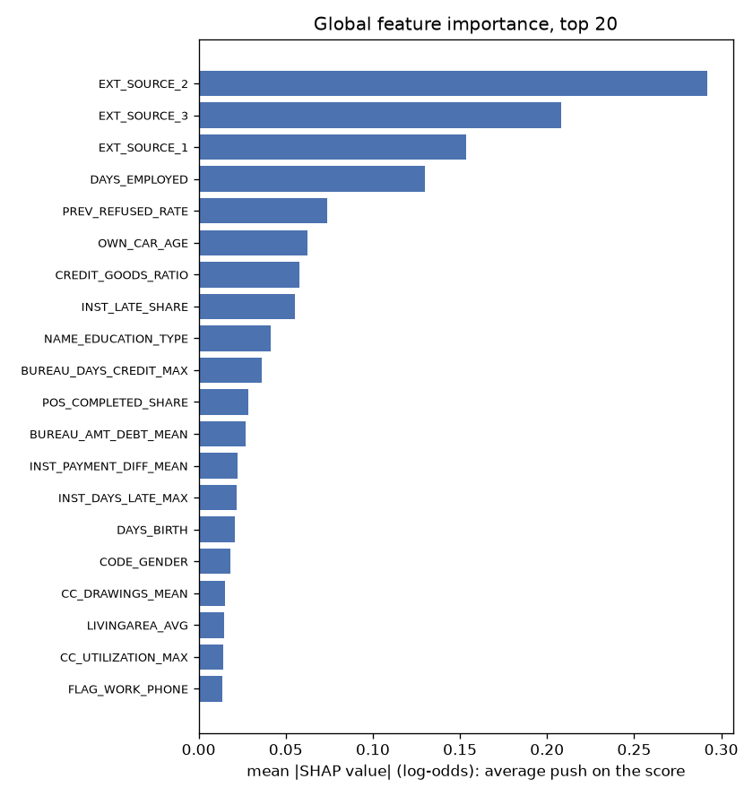
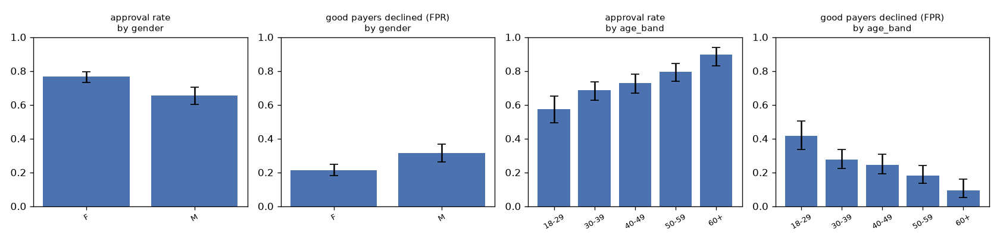

# Week 6 Wednesday checkpoint — November 18, 2026

Repository: [jparso32/machine-learning-ops](https://github.com/jparso32/machine-learning-ops).

Completed the official Wednesday starter's `explain_applicant` and `group_table` functions. The supplied tests, checker, report generation, and other provided code are unchanged. This checkpoint uses model version 1, the fixed 1,000-applicant validation split (81 defaulters), 164 features, and a decline threshold of 0.085. It does not use production outcomes.

## Checkpoint output

`python run.py check --stage wed`:

```text
check           result details
------------------------------------------------------------------------------------------
wed tests       PASS   6 passed in 6.24s
explanations    PASS   3 declined applicants explained; top features EXT_SOURCE_2, EXT_SOURCE_3, EXT_SOURCE_1
fairness table  PASS   approval by gender: F 77%, M 66%; proxy AUC 0.86
git authors     INFO   3 distinct commit author(s)
------------------------------------------------------------------------------------------
All required checks passed.
```

The captured command output is in [wednesday_check.txt](../reports/wednesday_check.txt). After `python run.py evaluate`, `python run.py ci` passed Ruff, all 220 tests (plus two previously documented expected failures), and the quality gate. Validation AUC is 0.736 (95% interval 0.682–0.789), with expected cost 0.564 per applicant. See [gate metrics](../reports/gate_metrics.json) and [CI output](../reports/wednesday_ci.txt).

## Three declined applicants and SHAP

The complete three explanations are in [explanations.md](../reports/explain/explanations.md), with machine-readable results in [explanations.json](../reports/explain/explanations.json).

| Applicant | Selection | Estimated default probability | Largest risk-raising reasons |
|---|---|---:|---|
| 386641 | Riskiest | 100.0% | External credit scores 2 and 3 below typical; higher share of earlier applications refused |
| 117334 | Typical decline | 17.2% | External credit scores 2 and 3 below typical; recent credit elsewhere |
| 357847 | Borderline decline | 9.1% | External credit scores 2 and 3 below typical; external credit score 1 missing |

The 100.0% is the fitted isotonic calibrator's estimate, not certainty about the applicant's outcome. SHAP contributions explain the underlying boosting model in **raw log-odds**; they are not probability-point changes in the calibrated output. The external scores provide the leading reasons, but a real applicant would need more information about those scores and a way to correct inaccurate or missing data. A missing score alone is not evidence of misconduct. The riskiest applicant's explanation also lists gender among factors lowering the score; that agrees with the existing gender sensitivity test and deserves investigation.

Globally, the leading five features are `EXT_SOURCE_2`, `EXT_SOURCE_3`, `EXT_SOURCE_1`, `DAYS_EMPLOYED`, and `PREV_REFUSED_RATE`. Credit history and employment therefore dominate this ranking. Income is not among the top 20; the earlier income sensitivity failure still requires investigation because global importance cannot rule out harmful individual behavior. The earlier gender test is also a documented expected failure, not a resolved issue. See [test findings](test_findings.md).



## Fairness table and largest gap

The full [fairness table](../reports/fairness/fairness.md) includes group counts, default rates, mean scores, approval rates, true positive rates (TPR), false positive rates (FPR), and 95% Wilson intervals. Its [JSON](../reports/fairness/fairness.json) contains the same results.

**The largest numerical gap is age-band TPR: 34.52 percentage points**, between ages 30–39 (67.9%) and 60+ (33.3%). We do **not** trust this as a precise population gap: it rests on only 28 and 6 defaulters, with overlapping intervals of 49–82% and 10–70%. All age-band TPR estimates have fewer than 30 defaulters and are flagged as unreliable.

The largest approval-rate gap is **32.17 percentage points**: ages 18–29 are approved 57.3% of the time (95% interval 49–65%), versus 89.5% for ages 60+ (83–94%). The corresponding good-payer decline rates are 41.7% (34–50%) versus 9.3% (5–16%), a **32.41-point FPR gap**. These separated intervals support taking the observed disparity seriously, while the validation sample and different group risk profiles limit generalization and causal conclusions. More held-out outcomes, especially defaulters in each age group, are needed.

By gender, F applicants have 76.5% approval versus 65.6% for M applicants, a 10.97-point gap. Good-payer decline rates are 21.2% versus 31.2%, a 10.01-point gap. Observed default rates also differ (5.7% versus 13.0%); the approval gap alone does not establish why it occurs. Mean scores are 7.2% and 9.8%, respectively, so group calibration also needs closer checking. A group average comparison is not a full calibration assessment.



The proxy model predicts gender from the other 163 features with validation AUC **0.863**. Its strongest single features include income, credit-to-income ratio, age, external score 1, and mean bureau credit amount. Removing `CODE_GENDER` alone would leave substantial information correlated with gender. These results describe model behavior on this validation sample; they do not prove a causal mechanism.

## Reproduce

With the team's existing private model and validation data available locally, run:

```sh
python run.py test tests/test_week6_wed.py
python run.py explain
python run.py fairness
python run.py evaluate
python run.py check --stage wed
python run.py ci
```

The checkpoint contains only source code, aggregate reports, and the three applicant IDs and reasons required by the provided starter. Private data and model files remain excluded from Git.
